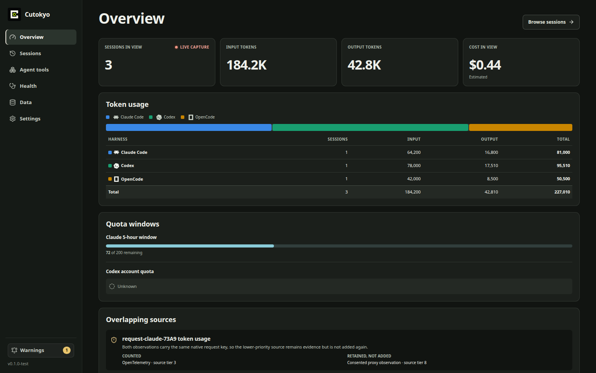
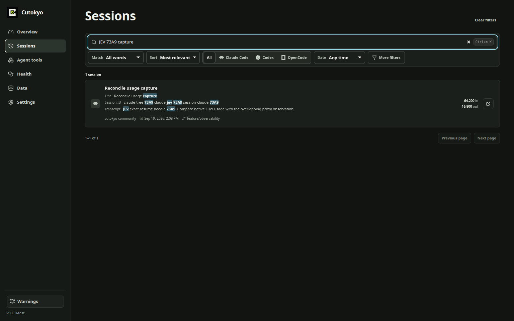
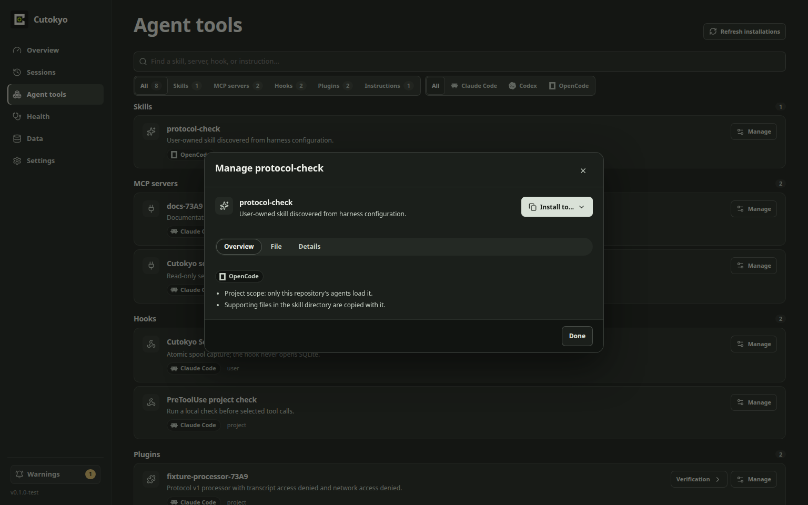

<div align="center">


# Cutokyo

**Your AI coding sessions, on your machine: searchable, attributable, resumable.**

Local history, exact resume and tool management for Claude Code, Codex and OpenCode.

[](LICENSE)
[](#status)
[](rust-toolchain.toml)
[](docs/clean-install.md)
[](docs/privacy.md)

[Website](https://cutokyo.com) · [Install](#install) · [CLI](#the-cli) · [Privacy](#private-by-default) · [Docs](#documentation)

<br />


<br /><sub>Overview with sample data</sub>

</div>

<br />

> [!NOTE]
> **Cutokyo is a `0.x` preview.** Data formats are versioned and migrate forward,
> but expect rough edges. See [status](#status).

## Why Cutokyo

You run agents all day: Claude Code in one terminal, Codex in another,
OpenCode for the side project. A week later you need the session where the
migration finally worked. Which tool was it? Which branch? Is it still
resumable?

Cutokyo answers that from your own disk. It records each session as it
happens through the harnesses' own hooks and local APIs. It indexes them
for full-text search and hands you back the **exact native session**, in a real
terminal, in the folder it ran in. It never routes your traffic through a cloud
service, and it has no account or telemetry.

It ships as **one native Rust application** with two frontends: a desktop app
and a CLI where every command also speaks JSON.

## What it does

<table>
<tr>
<td width="50%" valign="top">

### 🔎 Find any session

Full-text search over every captured prompt, tool call and reply. Search by
words or an exact phrase, filter by harness, project or date, and sort by
relevance or recency.

</td>
<td width="50%" valign="top">

### ↩️ Resume exactly where you left off

Reopens the native session ID in a visible terminal, in the recorded project
directory. Cutokyo doesn't rebuild the conversation; it reopens the harness's
own session.

</td>
</tr>
<tr>
<td valign="top">

### 🧰 Manage your agent tools

One inventory of every MCP server, skill, hook, plugin and instruction file
across all three harnesses. Read the real source, edit or remove it with a recovery copy kept,
or copy a skill into another harness with a preview first. `cutokyo sync` copies every
MCP server, skill and instruction file each harness is missing in one command.

</td>
<td valign="top">

### 📊 See usage across harnesses

Token usage per harness and quota windows. When two sources report the same
request, Cutokyo shows which one it counted and why, so nothing is counted
twice. Cost appears only when a harness reports it. Cutokyo doesn't make up
prices.

</td>
</tr>
<tr>
<td valign="top">

### 🩺 Know capture is healthy

Health checks separate "configured" from "actually capturing", with scoped
retries and a previewed diagnostic bundle that contains no prompts or
transcripts.

</td>
<td valign="top">

### 🗄️ Own your data

Retention policies with a preview, verified backups and restores, and
destructive actions that require you to type a confirmation for that exact
action.

</td>
</tr>
</table>

<div align="center">


</div>

## Supported harnesses

| Harness         | Capture                                | Parsers tested on |
| --------------- | -------------------------------------- | ----------------- |
| **Claude Code** | Hooks, OpenTelemetry, transcript files | `2.1.278`         |
| **Codex**       | App Server, hooks, OpenTelemetry       | `0.153.4`         |
| **OpenCode**    | Plugin, local app server               | `1.18.28`         |

> [!TIP]
> Native hooks, documented local APIs and OTel always come first. A local proxy
> exists only as an opt-in fallback that shows you what would leave the machine
> before you confirm. Setup works with any installed version on macOS, Linux and
> Windows: tested versions and newer are captured fully, older ones with
> unknown-version coverage.

## Install

Release builds ship as cargo-dist **shell**, **PowerShell** and **npm**
installers, all of which install the same native binary. Verify the published
SHA-256 manifest before first launch. See
[clean installation](docs/clean-install.md). Maintainers can use the
[npm release runbook](docs/release/npm.md) to bootstrap and publish the CLI channel.

From source, with the toolchain from [development](docs/development.md):

```bash
cargo run -p cutokyo-cli -- --help
```

Then let Cutokyo set itself up. Each step can be previewed first:

```bash
cutokyo setup --dry-run   # preview: creates nothing
cutokyo setup             # apply Cutokyo-owned state
cutokyo doctor            # is it actually ready?

cutokyo capture-setup --harness claude_code --dry-run
cutokyo capture-setup --harness claude_code
```

`cutokyo uninstall` is repeatable and keeps your history and your own
configuration.

## The CLI

Every command prints readable output, and `--json` gives a stable envelope
with safe error codes and distinct exit codes (`64` usage, `65` invalid
contract, `69` unavailable, `70` internal, `78` unhealthy).

```bash
cutokyo sessions search --query "migration" --project my-project
cutokyo sessions show SESSION_ID
cutokyo sessions resume SESSION_ID --execute

cutokyo inventory list
cutokyo inventory install ITEM_ID --revision REVISION --harness opencode
cutokyo sync --from claude_code --apply

cutokyo backup
cutokyo doctor --json
```

<details>
<summary><b>Full command tour</b></summary>

```bash
cutokyo sessions search --query "migration" --project my-project --json
cutokyo sessions show SESSION_ID
cutokyo sessions resume SESSION_ID            # exact command preview
cutokyo sessions resume SESSION_ID --execute  # acknowledged visible-terminal startup

cutokyo capture-setup --harness claude_code --dry-run
cutokyo capture-setup --harness claude_code
cutokyo capture-setup --harness claude_code --recover
cutokyo capture-setup --harness claude_code --uninstall

cutokyo retention preview --days 30 --write-plan retention-plan.json
cutokyo retention apply --plan retention-plan.json --confirm-digest DIGEST
cutokyo sessions delete SESSION_ID --confirm-session SESSION_ID
cutokyo sessions delete-all --confirm 'DELETE ALL LOCAL HISTORY'

cutokyo config list --show-origin
cutokyo spool status
cutokyo drain
cutokyo plugin verify ./my-plugin
cutokyo mcp manifest --json
cutokyo doctor --json
cutokyo bundle --output cutokyo-diagnostics.tar.gz
cutokyo backup                              # private default backup directory
cutokyo backup ./cutokyo-history-backup       # optional new directory
cutokyo restore ./cutokyo-history-backup      # verified preview only
cutokyo restore ./cutokyo-history-backup --confirm

cutokyo inventory list --json
cutokyo inventory show ITEM_ID --json
cutokyo inventory edit ITEM_ID --revision REVISION --content-file edited-source.json
cutokyo inventory install ITEM_ID --revision REVISION --harness opencode
cutokyo inventory remove ITEM_ID --revision REVISION --confirm-item ITEM_ID

cutokyo sync                              # preview what each harness is missing
cutokyo sync --from claude_code           # Claude Code's copy wins where copies differ
cutokyo sync --from claude_code --apply   # write it, keeping recovery copies
cutokyo sync --project ./my-project       # include that project's native files
```

Destructive commands preview exact scope and require a command-specific
confirmation. Deletion does not claim physical erasure from SSD blocks, WAL
pages, or prior backups.

</details>

The desktop app covers the same ground with onboarding, sessions, tool calls, agent tools,
health and data controls. See [desktop workflows](docs/desktop-workflows.md).

## Let your agents use it

`cutokyo mcp serve` gives Claude Code, Codex and OpenCode read-only tools over
your history: session search and details, usage, coverage, inventory, resume
targets, and `cutokyo_sql_query` for ad-hoc SQL over sessions, messages and tool
calls. The [`cutokyo` agent skill](skills/cutokyo/SKILL.md) teaches an agent when
and how to use them:

```bash
npx skills add lucasbabur/cutokyo --skill cutokyo
```

## Private by default

- **Local only.** No telemetry, no proxy and no provider egress unless you opt
  in, and every opt-in shows you the egress before you confirm.
- **Platform-native storage** with owner-only permissions where the OS supports
  them. Secrets go to the OS keychain, never to TOML.
- **Diagnostic bundles are allowlisted.** They never include prompts,
  transcripts, database bytes, secrets or full project paths. A crash record is
  added only when you pass `--include-crash`.

> [!WARNING]
> **Your history is stored unencrypted.** `0.x` does not encrypt the SQLite
> database itself, so session content may sit in plaintext on disk. Turn on
> full-disk encryption, and read [privacy and diagnostic bundles](docs/privacy.md)
> before enabling capture or sharing a bundle.

## How it's built

```text
cutokyo-cli             cutokyo-desktop
     └─────────────┬──────────────┘
                   v
            cutokyo-core::app
         ┌─────────┼──────────┐
      ingest      store     adapters
         └─────────┼──────────┘
                   v
            cutokyo-domain
      no fs / network / SQL / process
```

Harness hooks never open SQLite. They publish one flushed spool file by atomic
rename, and a single CLI or desktop core owns the writer lock. Both frontends
call the same application use cases. Details are in
[architecture](docs/architecture.md).

## Status

Cutokyo is a `0.x` preview. The app, database, projections, spool, plugin
protocol and structured CLI output each carry their own version. New binaries
migrate older data forward; older binaries refuse a newer database.

Cutokyo is **not** a coding harness, model provider, hosted memory service,
telemetry collector or invisible man-in-the-middle. Every feature is community
software under Apache-2.0, and no paid tier is held back.

## Documentation

|                                                               |                                                                      |
| ------------------------------------------------------------- | -------------------------------------------------------------------- |
| [Product contract](docs/spec/product.md)                      | [Desktop workflows](docs/desktop-workflows.md)                       |
| [Architecture](docs/architecture.md)                          | [Development](docs/development.md)                                   |
| [Privacy and diagnostic bundles](docs/privacy.md)             | [Plugin authoring](docs/plugin-authoring.md)                         |
| [Clean installation and uninstall](docs/clean-install.md)     | [Management workflow contract](docs/management-workflow-contract.md) |
| [Local backups and restore](docs/backup-and-restore.md)       | [Support](docs/support.md)                                           |
| [Release signing and notarization](docs/release/signing.md)   | [Release recovery](docs/release/recovery.md)                         |
| [Clean-room provenance](docs/provenance/clean-room-policy.md) | [Independent decision ledger](docs/provenance/decision-ledger.md)    |

## Contributing

Contributions are accepted under Apache-2.0 and the Developer Certificate of
Origin 1.1, so sign off every commit with `git commit -s`. Read
[`CONTRIBUTING.md`](CONTRIBUTING.md), the clean-room policy and the decision
ledger before changing product or test files.

<br />

<div align="center">
<sub>Apache-2.0 · Claude Code, Codex, OpenCode, OpenAI, Anthropic, Tauri and SQLite are marks or names of their respective owners. See <a href="TRADEMARK.md">TRADEMARK.md</a>.</sub>
</div>
